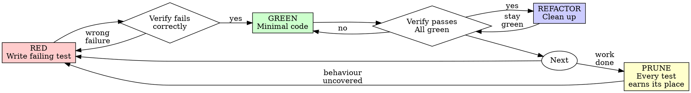

# Test-Driven Development

Executes the red-green-refactor cycle: one failing test, watched failing for the right reason, the minimal code that passes it, then clean-up while everything stays green.

## The Cycle



## Before the First RED: Record the Base

Before the first RED of a piece of work, record the commit you start from with `git rev-parse HEAD`. Also record the files that `git status --porcelain -uall` already shows as changed. Without `-uall`, git collapses an untracked directory into one entry and hides the files inside it. The prune uses the recorded base and file list to find the files this work touched. If a calling skill supplies its own base and list of already-changed files, use those instead.

## RED: Write a Failing Test

Write one minimal test that expresses the behaviour you want. Name it as a complete phrase describing the behaviour. Exercise real code.

<Good>
```typescript
test('retries failed operations 3 times', async () => {
  let attempts = 0;
  const operation = () => {
    attempts++;
    if (attempts < 3) throw new Error('fail');
    return 'success';
  };

  const result = await retryOperation(operation);

  expect(result).toBe('success');
  expect(attempts).toBe(3);
});
```
</Good>

<Bad>
```typescript
test('retry works', async () => {
  const mock = jest.fn()
    .mockRejectedValueOnce(new Error())
    .mockRejectedValueOnce(new Error())
    .mockResolvedValueOnce('success');
  await retryOperation(mock);
  expect(mock).toHaveBeenCalledTimes(3);
});
```
Vague name, and it tests the mock rather than the code under test.
</Bad>

## Verify RED: Watch It Fail

Run the test:

```bash
npm test path/to/test.test.ts
```

Confirm:

- The test fails (it does not error)
- The failure message is the one you expected
- The failure is because the feature is missing, not because of a typo or import error

If the test passes, you are exercising behaviour that already exists. Fix the test.
If the test errors, fix the error and re-run until the test fails for the right reason.

## GREEN: Minimal Code to Pass

Write the simplest code that makes the test pass.

<Good>
```typescript
async function retryOperation<T>(fn: () => Promise<T>): Promise<T> {
  for (let i = 0; i < 3; i++) {
    try {
      return await fn();
    } catch (e) {
      if (i === 2) throw e;
    }
  }
  throw new Error('unreachable');
}
```
</Good>

<Bad>
```typescript
async function retryOperation<T>(
  fn: () => Promise<T>,
  options?: {
    maxRetries?: number;
    backoff?: 'linear' | 'exponential';
    onRetry?: (attempt: number) => void;
  }
): Promise<T> {
  // YAGNI
}
```
Over-engineered. The test did not ask for options.
</Bad>

## Verify GREEN: Watch It Pass

Run the test:

```bash
npm test path/to/test.test.ts
```

Confirm:

- The new test passes
- All other tests still pass
- Output is pristine, no warnings, no stray errors

If the new test fails, fix the code, not the test.
If other tests fail, fix them now before continuing.

## REFACTOR: Clean Up While Green

Only once the test is passing:

- Remove duplication
- Improve names
- Extract helpers

Keep every test green throughout. Do not add new behaviour during refactor.

## Repeat

Write the next failing test for the next piece of behaviour.

## PRUNE: Every Test Earns Its Place

Prune once, after the last behaviour of the piece of work is green and refactored. The prune comes before the Completion Gate and any review. Each cycle justified one test against one behaviour, but together the tests overlap. Common examples are a second case from the same input class and an assertion on incidental structure. Others are a test of a mock and a test of a helper extracted during REFACTOR. A test that catches no defect another test misses costs maintenance and protects nothing. The prune applies to bug fixes under the same rules, so a regression test earns its place like any other test.

### Scope

The prune covers every test in every touched file, whether this work added the test or it existed before. A touched file is one changed since the recorded base, and that includes a production file whose inline test module changed. Files that were already changed at the base are excluded unless this work edited them. Test files that the work did not change are out of scope, even when they cover changed code. Report any over-testing you notice there to your human partner in a separate list.

### Procedure

1. **Build the touched-file list.** Take `git diff --name-only <base>` and the untracked files from `git status --porcelain -uall`. Remove the files recorded as already changed at the base. Then add back each of those files that you edited during this work.
2. **Dispatch the auditor.** Fill the prompt template below and dispatch it with `Agent`. Pass no session history, and let the dispatch inherit the session model.
3. **Check each surviving test.** Every REMOVE names a surviving test. A valid survivor is a KEEP in the same audit or a test outside that audit's `[SCOPE]`. It can also be `none`, when the removed test cannot fail. If a REMOVE fails this check, treat it as KEEP.
4. **Apply the removals.** Apply every REMOVE, unless you can name a defect that only that test catches and the auditor missed. Keep such a test and state its defect in your completion report.
5. **Remove test cases, never files.** Deleting a tracked file is destructive under `../../rules/common/git.md`. If the removals would leave a file with no tests, keep its last test. Report that file to your human partner.
6. **Return to RED for an uncovered behaviour.** If the auditor reports a behaviour with no test, write its failing test and run the cycle. Then prune again with `[SCOPE]` set to only the tests added since the previous audit.
7. **Verify GREEN.** Run the full suite. Confirm that every test passes and that the output is pristine.

If `Agent` is unavailable, answer the auditor's questions yourself over the same scope. State in your completion report that the audit was a self-audit.

### The Auditor Prompt

Fill every placeholder, and leave none unreplaced in the dispatched prompt.

| Placeholder         | What goes in it                                                                                                                                                   |
|---------------------|-------------------------------------------------------------------------------------------------------------------------------------------------------------------|
| `[WHAT_WAS_BUILT]`  | One line naming the piece of work.                                                                                                                                |
| `[BEHAVIOURS]`      | The behaviours this piece of work set out to deliver, one per line.                                                                                               |
| `[TOUCHED_FILES]`   | The touched-file list from step 1.                                                                                                                                |
| `[SCOPE]`           | `every test in the files above` on the first audit. After a return to RED, the names of the tests added since the previous audit.                                 |
| `[TEST_VALUE_RULE]` | The Meaningful Assertions section of `../../rules/common/testing.md`, pasted whole. That rule file is always on, so its canonical text is in context at dispatch. |

```yaml
Agent (general-purpose):
  description: "Test audit: [WHAT_WAS_BUILT]"
  prompt: |
    You are auditing tests so that every test earns its place. You change
    nothing. Do not edit, create, or delete any file, and do not run tests or
    any command that changes state. Judge each test by reading it and the
    production code it exercises.

    ## The Rule

    [TEST_VALUE_RULE]

    ## The Behaviours This Work Delivers

    [BEHAVIOURS]

    ## Files in Scope

    [TOUCHED_FILES]

    Audit: [SCOPE]

    ## For Each Test

    1. Name the concrete defect in the production code that makes this test
       fail. If you cannot name one, the test cannot fail. Its verdict is
       REMOVE, with the surviving test `none`.
    2. Look for another test, in any file, that also fails on that defect.
    3. If one exists, the verdict is REMOVE, and that test is the surviving
       test. Otherwise the verdict is KEEP, with the defect that only this
       test catches.

    A surviving test is valid only when it is a KEEP in this audit, a test
    outside the tests you were asked to audit, or `none` because the removed
    test cannot fail. Check every REMOVE against that rule
    before you return. Two duplicates that each name the other cannot both be
    removed, so keep one of them.

    ## Coverage

    Map each behaviour above to the tests that still cover it after your
    REMOVE verdicts. Report every behaviour that has no covering test.

    ## Output Format

    ## Test Audit

    **Verdicts:**
    - `file` :: `test name`: KEEP - [the defect only this test catches]
    - `file` :: `test name`: REMOVE - survivor `file` :: `test name` - [the shared defect]

    **Uncovered behaviours:** [each behaviour with no covering test, or `none`]

    **Outside scope:** [over-testing noticed in files outside scope, or `none`]
```

## Worked Example: Bug Fix

**Bug:** Empty email accepted.

**RED**

```typescript
test('rejects empty email', async () => {
  const result = await submitForm({ email: '' });
  expect(result.error).toBe('Email required');
});
```

**Verify RED**

```bash
$ npm test
FAIL: expected 'Email required', got undefined
```

**GREEN**

```typescript
function submitForm(data: FormData) {
  if (!data.email?.trim()) {
    return { error: 'Email required' };
  }
  // ...
}
```

**Verify GREEN**

```bash
$ npm test
PASS
```

**REFACTOR**
Extract validation for multiple fields if the pattern repeats.

## Completion Gate

Before claiming the piece of work complete, confirm every box:

- [ ] Every new behaviour has a test
- [ ] You watched each test fail before implementing
- [ ] Each test failed for the expected reason, not a typo or import error
- [ ] You wrote only the minimal code to pass each test
- [ ] All tests pass
- [ ] Output is pristine
- [ ] Tests exercise real code, mocks only at true boundaries
- [ ] Edge cases and error paths that the behaviour defines each have a test
- [ ] The prune ran, and every remaining test in the touched files names a defect that only it catches, or was kept under step 3 or step 5 of the prune

If any box is unchecked, you skipped part of the cycle.

## When Stuck

| Problem                     | Response                                                                       |
|-----------------------------|--------------------------------------------------------------------------------|
| Don't know how to test it   | Write the wished-for API. Write the assertion first. Ask your human partner.   |
| Test is too complicated     | The design is too complicated. Simplify the interface.                         |
| Must mock everything        | Code is too coupled. Use dependency injection.                                 |
| Test setup is huge          | Extract helpers. If still complex, simplify the design.                        |

## Common Rationalisations

You will be tempted to skip TDD. Every excuse below means **recover a genuine RED**:

| Excuse                                        | Reality                                                                         |
|-----------------------------------------------|---------------------------------------------------------------------------------|
| "Too simple to test"                          | Simple code breaks. The test takes thirty seconds.                              |
| "I'll test after"                             | Tests passing immediately prove nothing.                                        |
| "I already manually tested it"                | Manual testing has no record and cannot be re-run.                              |
| "The code is already written"                 | It is unverified. Stash the change, watch RED, restore the change, watch GREEN. |
| "The test is hard to write"                   | Hard to test means hard to use. Fix the design.                                 |
| "I must mock everything"                      | Code is too coupled. Use dependency injection.                                  |
| "TDD will slow me down"                       | TDD is faster than debugging in production.                                     |
| "Existing code has no tests"                  | You are improving it. Add the test.                                             |
| "Just this once" / "this case is different"   | No.                                                                             |

## Red Flags: Stop and Recover RED

If any of the following is true, stop immediately and recover a genuine RED, watching the test fail for the right reason before the code that passes it is accepted. If the production code already exists, stash or disable it until you have watched that failure:

- You wrote code before a test
- A test passed immediately on its first run
- You cannot explain why a test failed
- You are about to say "just this once" or "this case is different"

There are no exceptions without explicit permission from your human partner.

## Testing Anti-Patterns

When adding mocks or test utilities, read `testing-anti-patterns.md` to avoid:

- Testing mock behaviour instead of real behaviour
- Adding test-only methods to production classes
- Mocking without understanding dependencies
